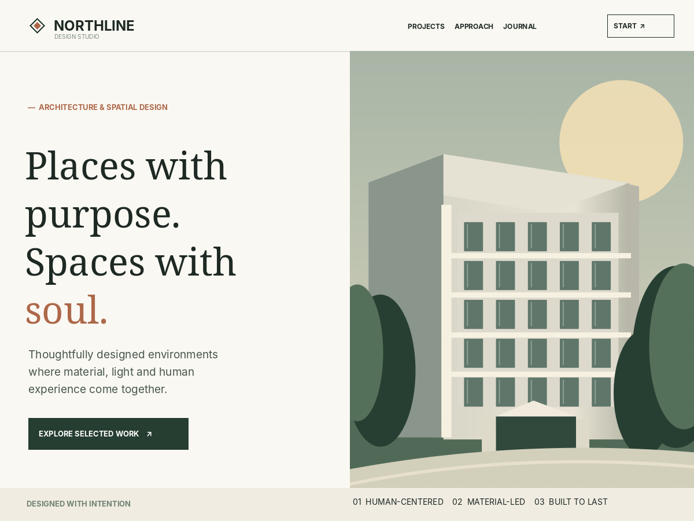

# NORTHLINE — Bespoke WordPress Engineering Showcase

> **Original WordPress theme + companion plugin + interactive visual preview.** Built as a technical portfolio sample for a senior custom WordPress developer application.

**[VIEW THE STATIC VISUAL DEMO](https://YOUR-GITHUB-USERNAME.github.io/northline-wordpress-showcase/)** (enable GitHub Pages using the instructions below). The static demo is not WordPress: dynamic features require a running WordPress instance.



## Why this project exists

A hiring manager requested an **expert WordPress developer who can build from scratch, without starting from a prebuilt theme**, and who can demonstrate code quality *under the hood*. This repository provides a focused example of how to structure a bespoke theme and preserve content in a standalone plugin. It is intentionally **not an Elementor/Divi child theme, copied commercial template, or generic HTML-only mockup**.

All architecture-studio branding and example projects are **fictional demonstration content**, not client work or testimonials. Visual assets were authored specifically for this example; no third-party stock photos are bundled.

## What to inspect

| Capability | Implementation | Source |
| --- | --- | --- |
| Custom PHP theme | Native template hierarchy, hooks, reusable template helpers | [`functions.php`](wp-content/themes/northline/functions.php), [`front-page.php`](wp-content/themes/northline/front-page.php) |
| Portfolio CMS | Plugin-owned custom post type `nl_project` and taxonomy `nl_sector` | [`northline-core.php`](wp-content/plugins/northline-core/northline-core.php) |
| Structured content | Registered REST-compatible project meta fields + an admin meta box | [`northline-core.php`](wp-content/plugins/northline-core/northline-core.php) |
| Custom Gutenberg block | `block.json` metadata, server-side rendered project grid + adjustable number of projects | [`projects-block.js`](wp-content/plugins/northline-core/assets/js/projects-block.js) |
| Editable hero | WordPress Customizer with sanitized text, textarea and email controls | [`customizer.php`](wp-content/themes/northline/inc/customizer.php) |
| Front-end craft | Responsive, independent CSS; original SVG illustrations; keyboard-friendly mobile navigation | [`main.css`](wp-content/themes/northline/assets/css/main.css), [`site.js`](wp-content/themes/northline/assets/js/site.js) |
| Engineering hygiene | Escaping, capability checks, nonces, versioned assets, PHP lint, CI | [`.github/workflows/quality.yml`](.github/workflows/quality.yml) |

### Project structure

```text
northline-wordpress-showcase/
├── wp-content/
│   ├── themes/northline/
│   │   ├── front-page.php, header.php, footer.php, index.php, ...
│   │   ├── inc/                   # Customizer and template helpers
│   │   ├── assets/                # CSS, JS, self-authored SVG
│   │   ├── theme.json
│   │   └── screenshot.png
│   └── plugins/northline-core/
│       ├── northline-core.php     # CPT, taxonomy, post meta, Gutenberg block, WP-CLI demo seed
│       └── assets/
├── docs/                       # GitHub Pages: STATIC visual preview only
├── scripts/                    # Static quality checks
├── .github/workflows/          # CI
├── ARCHITECTURE.md
└── QA_REPORT.md
```

## Install on a local WordPress site

**Requirements:** WordPress **6.6+**, PHP **8.0+**, MySQL/MariaDB as supported by the WordPress version. No external JS frameworks or paid WordPress plugins are required.

1. Start with a working local WordPress install (e.g. Local, DDEV, or a WordPress-enabled server). This repository does **not** include WordPress core, a database, or a live production deployment.
2. Copy `wp-content/themes/northline/` into your WordPress site's `wp-content/themes/` directory.
3. Copy `wp-content/plugins/northline-core/` into your site's `wp-content/plugins/` directory.
4. In **Plugins**, activate **Northline Core**. Then in **Appearance → Themes**, activate **Northline Studio**.
5. In **Settings → Permalinks**, select a friendly permalink structure and **Save Changes** if `/projects/` returns 404.
6. In **Settings → General**, set a demo name/description if desired. Visit **Appearance → Customize → Northline — Homepage** to edit the headline, introduction and contact email.
7. In **Projects → Add New**, add actual portfolio items with excerpt, featured image, sector, and project details. They will automatically appear on the homepage and project archive.
8. Add a page, open the Gutenberg editor, insert **Northline / Project Grid**, and set the number of visible projects in the Inspector panel.

**Optional WP-CLI seed, on an isolated demo installation only:**

```bash
wp northline demo-seed
```

This creates four clearly labeled *fictional concept* projects. It is idempotent by slug and **never runs during plugin or theme activation**. Avoid seeding a production website.

**Optional local CLI checks:**

```bash
find wp-content -name '*.php' -print0 | xargs -0 -n1 php -l
node --check wp-content/themes/northline/assets/js/site.js
node --check wp-content/plugins/northline-core/assets/js/projects-block.js
python3 scripts/validate.py
```

## Enable a clickable GitHub Pages design preview

1. Create a **public** GitHub repository named `northline-wordpress-showcase`.
2. Upload the contents of this repository to the root of the new repository. **Do not upload the outer ZIP as a single file.**
3. In **Settings → Pages**, choose **Deploy from a branch** → branch `main` → folder `/docs` → **Save**.
4. After GitHub Pages finishes publishing, your static preview URL will usually follow this format: `https://YOUR-GITHUB-USERNAME.github.io/northline-wordpress-showcase/`.
5. Replace the placeholder URL above with your real published URL. The linked project pages work in the static preview, but Gutenberg, CMS editing, taxonomy queries and WP-CLI exist only in the WordPress code.

> The `/docs` directory is a **visual-only demonstration**, not an exported functioning WordPress installation. The actual WordPress theme and plugin source are under `wp-content/`.

## Important review notes

- This sample intentionally uses a **classic PHP theme augmented by `theme.json`**: good for demonstrating PHP template hierarchy and WordPress hooks while respecting current block editor conventions.
- The plugin owns all custom content types so site content can outlive the theme.
- There are no fabricated Lighthouse scores, conversion results, real customer projects, or claims about a production deployment.
- Contact links use `mailto:` and an editable email address. There is **no contact-form backend** in this sample.
- Static syntax and source checks have been performed; **end-to-end runtime validation on a live WordPress installation has not been performed in this environment**. See [QA_REPORT.md](QA_REPORT.md).
- Before sharing this repository as your professional work sample, review the code, customize the owner information and ensure you can discuss its decisions in an interview.

**Maintainer:** Gurwinder Singh  
**GitHub upload walkthrough:** [UPLOAD_TO_GITHUB.md](UPLOAD_TO_GITHUB.md)  
**Application email draft:** [EMAIL_TO_CLIENT.md](EMAIL_TO_CLIENT.md)  
**License:** GPL-2.0-or-later (code; original illustration assets included for this demo)
